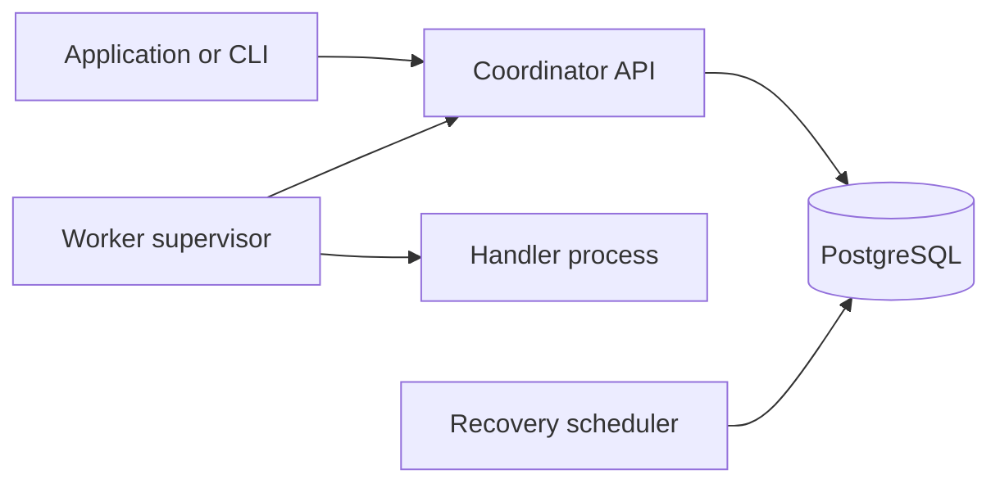

# Relevo

A durable background-task engine built with Python and PostgreSQL. Relevo saves work before acknowledging it, assigns it to workers, and recovers expired assignments within a bounded retry budget.

**[Explore the website](https://relevo-engine.vercel.app/)** · [How it works](docs/how-it-works.md) · [Architecture](docs/architecture.md) · [Measurements](benchmarks/README.md)

## Why it exists

A worker can crash after accepting a task. A network response can disappear after a result was saved. An earlier worker can return after another attempt has started. Relevo coordinates those cases while preserving the job, each attempt, and committed history.

It is a systems engineering portfolio project with reproducible failure tests and recorded evidence. It is not a hosted multi-tenant task service.

## What it does

- Commits accepted tasks and deduplicates matching idempotency keys.
- Claims eligible work through short PostgreSQL transactions.
- Uses renewable leases, worker identities and fencing tokens to validate updates.
- Supervises registered handlers in separate processes with execution deadlines.
- Recovers expired assignments with backoff and a saved attempt limit.
- Keeps attempts and transition history alongside immutable terminal outcomes.

Execution may repeat. External effects need their own idempotency protection; Relevo does not promise exactly-once execution or uninterrupted availability.

## Architecture



The website explains the engine using static recordings and measurements. It runs independently of the backend and never receives its private token.

## Run the engine locally

Requires Git, Python for the setup script, and Docker with Linux containers. Docker supplies the backend Python and PostgreSQL runtimes.

```bash
git clone https://github.com/Tirthpanchori/Relevo.git
cd Relevo
python scripts/configure.py
docker compose up --build -d --wait --wait-timeout 90
docker compose exec -T api python -m relevo --api-url http://127.0.0.1:8000 demo --key my-first-task
```

The setup script creates private `.env` credentials once and preserves existing values. The demo submits a hashing task, waits for completion and prints its history. Built-in handlers hash a payload, wait, or deliberately fail a configured number of attempts. Report generation is an integration example, not a built-in handler.

API documentation: [localhost:8000/docs](http://localhost:8000/docs). Readiness: [localhost:8000/health/ready](http://localhost:8000/health/ready). Task operations require the server-side bearer token.

```bash
docker compose stop
```

Stopping preserves the database volume. See [deployment and backups](docs/deployment.md) before changing storage or exposing the API.

## Run the website locally

With Node.js 24 installed:

```bash
cd frontend
npm ci
npm run dev
```

Open [localhost:5173](http://localhost:5173/). The backend is not required for the website's Flow, recorded Replay or Results.

On Windows, `./scripts/frontend.ps1 dev` from the repository root can prepare a project-local Node runtime instead. See [testing](docs/testing.md) for production-build and browser-check commands.

## Evidence

The release verification recorded **197 backend tests**, **23 browser tests**, and **21 automated accessibility scans with zero violations**. These are dated results, not a live test counter or cloud certification.

- [Testing and verification](docs/testing.md): commands, CI and verification limits.
- [Failure recordings](artifacts/replays/README.md): worker crashes, restarts and repeated business effects.
- [Benchmark methodology](benchmarks/README.md): 1,440 measured jobs, raw data, regressions and exclusions.

The default worker monitor interval remains 50 ms. Optional 5 ms polling helped some short-task cases and regressed timed workloads; the results do not establish a universal speedup.

## Documentation

| Guide | Covers |
|---|---|
| [How it works](docs/how-it-works.md) | Lifecycle, terminology, recovery and limitations |
| [Architecture](docs/architecture.md) | Transactions, ownership, idempotency and technical tradeoffs |
| [Deployment](docs/deployment.md) | Vercel website, local Docker engine and backups |
| [Testing](docs/testing.md) | Reproduction commands and retained verification |
| [Security](SECURITY.md) | Trusted-cluster access and credential handling |

Source: `backend/src/relevo` contains the engine, API, client, workers and migrations; `frontend/src` contains the explanatory website; `scripts` contains setup, smoke, benchmark and backup tools. `infra` contains optional monitoring and network-fault configuration.

The original model uses the MIT-licensed Anatomy projection kit; see its [notice](frontend/src/anatomy/NOTICE.md). Self-hosted font licences are included in the website build.
