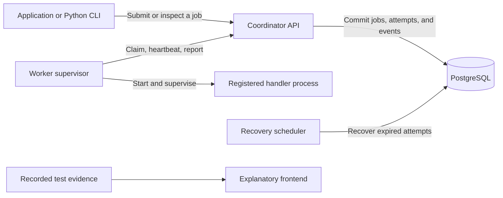
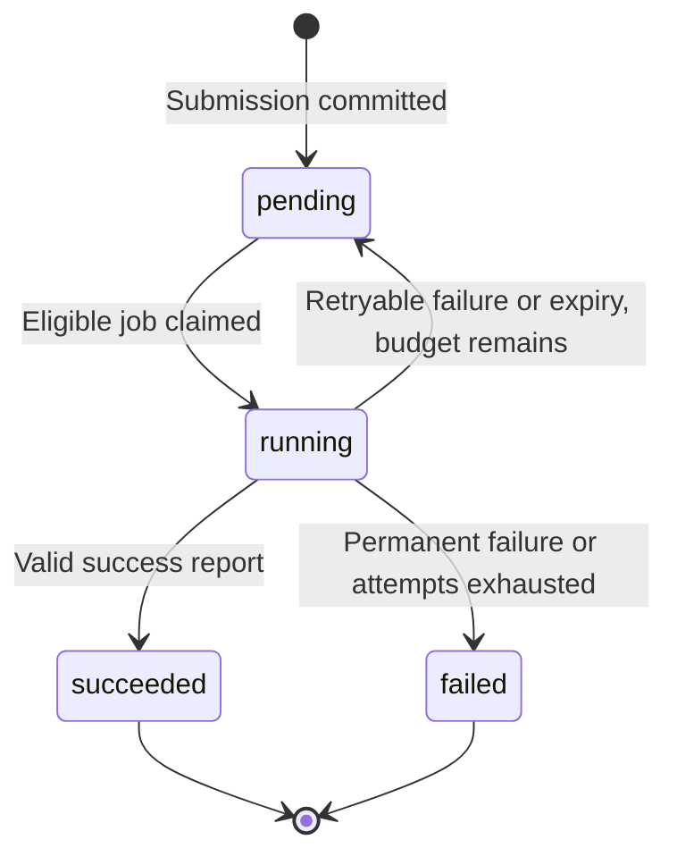

# How Relevo works

Last updated: 2026-10-17 (Asia/Calcutta).

**Current status:** Phases 1-6 are verified locally: 185 tests pass on Windows and Linux, plus three further rounds of 81 integration checks. The client/CLI, TCP failures, actual component crashes/restarts, and business-effect comparison are implemented. Phase 7 observability and benchmarks are underway. Frontend work waits for a conversation after the backend gate. See [implementation-plan.md](implementation-plan.md) for evidence and [decision.md](decision.md) for rationale.

## The idea in simple terms

Relevo handles background work for another application. An application gives it a task, gets a job ID after the task is saved, and checks that ID for progress or a result. Separate programs called workers do the actual work.

For example, a reporting application could ask for a CSV report and respond to its user immediately. A worker would build the report while the main application handles other requests. Report generation is an integration example; v1's built-in handlers are hashing a payload, timed work, and deliberately failing a configured number of attempts.

Relevo's central problem is deciding what to do when a worker disappears or a message gets lost. It tracks ownership, notices expired assignments, and allows another attempt within the retry limit.

The frontend explains the engine using recorded evidence. It is not required to execute jobs and does not expose privileged worker controls.

## The main pieces

| Piece | Simple explanation |
|---|---|
| Coordinator API | The front desk: accepts jobs, answers status requests, and handles worker requests. |
| PostgreSQL | The durable notebook: stores accepted work, ownership, outcomes, and history. |
| Worker supervisor | Takes one assignment, starts its task, renews ownership, and reports the outcome. |
| Handler process | Runs the actual registered Python task under the supervisor's limits. |
| Recovery scheduler | Finds expired assignments and either schedules another attempt or records final failure. |
| Python client/CLI | Lets a developer submit, inspect, and demonstrate jobs without a browser. |
| React frontend | Explains the architecture, lifecycle, recovery demonstrations, and measured results. |

API, workers, and scheduler run independently. PostgreSQL is the shared authority; a worker's memory is not proof that it still owns a job.

## What happens to one job

1. **Submit.** The application sends a task name, JSON payload, and idempotency key to `POST /jobs`. It can include `run_at` to delay eligibility.
2. **Save before answering.** The API saves the job and its submission event in one database transaction. It acknowledges acceptance only after commit.
3. **Claim.** A worker asks for work. A short transaction assigns one eligible pending job and creates its first attempt, lease, and fencing token. Competing workers cannot both obtain current valid ownership for that job.
4. **Execute.** The supervisor starts a registered handler in a child process. Database locks are already released; task code does not run inside the claim transaction.
5. **Stay in touch.** The worker sends heartbeats to renew its assignment while the child runs. Renewal succeeds only for the current unexpired owner.
6. **Finish.** The worker reports success or failure. The engine checks ownership again and commits the outcome with its history. The application can inspect the job and its attempts.

If there is no eligible job, the worker waits and asks again. A delayed job stays pending until its availability time; a retry also waits until its backoff ends.

Terminal jobs cannot be reset in v1. Three total attempts means the first try plus at most two more, not three retries after the first.

## Job, attempt, lease, and token

A **job** is the work requested. An **attempt** is one assignment to execute it. One job can therefore have several attempts, including attempts whose worker died before doing useful work.

A **lease** is time-limited permission to report new progress/outcomes for an assignment. The default is 15 seconds, renewed by a heartbeat every 5 seconds. An unrenewed lease expires even if the scheduler has not noticed it yet.

A **fencing token** is a number that increases for each new attempt on the same job. If an earlier worker comes back, its old attempt/token cannot change the newer job state. The engine also checks worker identity and expiry. PostgreSQL time makes that decision, so disagreeing worker clocks do not decide ownership.

The ownership API now checks this after obtaining database locks and again at its guarded ownership write. If a request starts in time but waits for a lock until its lease expires, it is rejected. Heartbeats extend an existing lease without shortening it; they do not create another attempt or transition event.

The worker receives lease duration from the coordinator and counts elapsed time with a monotonic clock. It does not decide ownership by comparing the database timestamp to its own wall clock. The child writes a bounded result atomically into a private temporary directory; the supervisor keeps checking deadlines and heartbeats while the child runs. On an unconfirmed renewal it stops and reaps the child. Spawned-handler and supervisor tests pass on Windows and Linux.

There can be at most one valid lease for a job. That does not mean two processes can never physically run task code at once during a failure: an isolated or orphaned old process may still run. Its stale reports are rejected; its external effects need separate protection.

## When a worker disappears

Suppose worker A claims a job and crashes. Its lease stops being renewed. The recovery scheduler, which normally scans every 2 seconds, finds the expired attempt and records it. If attempts remain, it returns the job to pending with a retry delay. Worker B can claim it when eligible and receives a new token.

The scheduler runs as its own program, independently of API startup. Each scan handles a bounded batch (100 by default). Two schedulers can scan together: they skip locked jobs and recheck ownership after obtaining locks. The attempt expiry, retry or final failure, and history commit together. If a scan crashes before committing, PostgreSQL rolls the transaction back; the next scan discovers the still-expired assignment. A stopped scheduler delays recovery, while the accepted job remains saved and stale reports remain rejected.

Both reported retryable failures and recovered expiries schedule another attempt with a delay between half and all of an exponential ceiling (default 1-second base, 30-second cap). If the total-attempt budget is exhausted, the job becomes failed. Expired attempts stay in history with a `lease_expired` error; the replacement is a new attempt rather than a rewrite of the old one.

If A later reports completion, the engine rejects its stale outcome. B owns the new attempt. If the retry budget is exhausted, the job becomes failed instead of retrying forever.

Recovery restarts the handler from its beginning. It does not continue from the instruction where A stopped. Recovery also depends on the database, scheduler, coordinator, and a worker being available; the scan interval is not a recovery-time guarantee.

## When the work succeeded but the response got lost

There are two different kinds of retry safety:

- **Submission:** repeat the same idempotency key and normalized task request to get the existing job. Using that key for different work is a conflict. Use the original key when an acceptance response is lost.
- **Outcome reporting:** repeat the same completion/failure report from the matching attempt to acknowledge an already committed outcome. This adds no new transition and does not restore expired ownership. A changed report conflicts.

The outcome response is the original historical acknowledgment. For example, replaying an old failure may acknowledge that it scheduled a retry even though that retry has since succeeded. Inspect the job to see its current state. Already-committed content keeps its identical acknowledgment after a configured payload/result admission limit is reduced; that exception does not admit new over-limit work or bypass the absolute raw request cap.

These rules resolve lost responses around engine transactions. They do not automatically prevent a handler's business effect from happening twice.

For example, a handler might update another application's balance and then crash before reporting completion. Relevo may run it again. The implemented demonstration compares two ledger effects after repeated unprotected execution with one protected effect. A stable business-operation key, checked in the same transaction as the effect, protects that operation. An attempt ID is unsuitable because it changes on retry. The instrumented harness and real committed records are explained in the [recording guide](artifacts/replays/README.md).

Relevo does not guarantee exactly-once execution or exactly-once external effects. A remote service needs its own effect-safety mechanism.

## What is stored

| Table | Purpose |
|---|---|
| `jobs` | The submitted task, scheduling, current state, current ownership reference, and final result/error. |
| `attempts` | Each assignment's worker, attempt number/token, lease, timing, and outcome. |
| `job_events` | Ordered committed history explaining changes to the job. |
| Separate demo ledger | Business effects used to prove duplicate-execution and idempotency behavior. |

State and its transition history commit together. Operational logs/metrics help diagnose behavior, but they do not replace the durable event history. Runtime counters can reset when a process restarts.

Metrics distinguish those two views. Current job counts, committed retries/expiry,
queue delay, and attempt duration come from saved database records. HTTP/database
latency and worker execution measurements describe the current process. A worker
trace follows its coordinator requests so the claim and report can be inspected
together. Identifiers appear in structured logs/traces; payloads and credentials
are omitted. Optional local Prometheus/Grafana/Jaeger help inspect these signals.
Their temporary data is not a substitute for job history or a backup.

## Limits and trust

Defaults are a 60-second execution limit, 64 KB payload/result limits, and three total attempts. Timing and retry settings are configurable. Payload/result limits are 65,536 bytes of canonical UTF-8 JSON; raw POST bodies are bounded at 1 MiB. Invalid JSON, null characters, invalid Unicode, and excessive nesting are rejected. The supervisor enforces execution deadlines and stops/reaps children when renewal cannot be confirmed.

Handlers are registered in trusted Python code. Users cannot upload executable tasks. The v1 cluster uses a shared environment-provided API token; it does not provide tenant isolation or separate user accounts. That token must never appear in the public frontend.

PostgreSQL persistence is essential. The design targets process crashes and temporary network failures with surviving durable storage. It does not promise recovery from destroyed storage, uninterrupted availability, or successful execution of every task. Backups and an actually tested restore procedure are separate operational work.

## How we will demonstrate this

PostgreSQL/TCP tests cover the failure matrix and check accounting after every test. Actual smoke scripts kill workers and PostgreSQL, pause recovery, restart components, and verify acknowledged jobs and terminal outcomes survive. Sanitized recordings preserve committed events and label controlled interventions. Identical workloads have been measured with 1, 3, and 5 workers; [the comparison](benchmarks/comparison.md) and [confirmation](benchmarks/confirmation.md) include raw timings, resource use, variation, and limitations.

We also tried checking for finished child processes more often: every 5 ms instead
of 50 ms. It helped some short-task cases but slowed timed work in the confirmation.
The default remains 50 ms; 5 ms is an optional worker setting for workloads where
local measurements justify it. Starting a separate process for every task still
has a cost. These are local measurements, not a promise about other machines.

The backend gate has passed, including a fresh-checkout run and hosted CI. After
the required frontend conversation, the public explanation can replay these
actual captured events, clearly labeled with their source and revision. A visitor
will be able to explore failure/recovery while the live engine is offline. The
complete engine already runs locally through Compose. The build order and
evidence are in [implementation-plan.md](implementation-plan.md).
